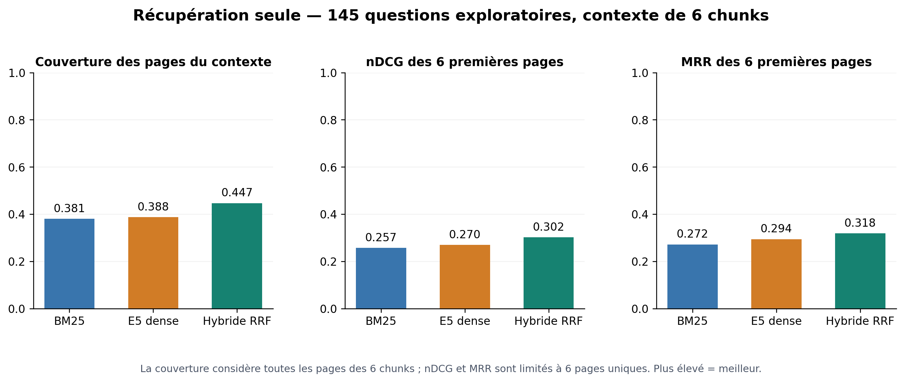
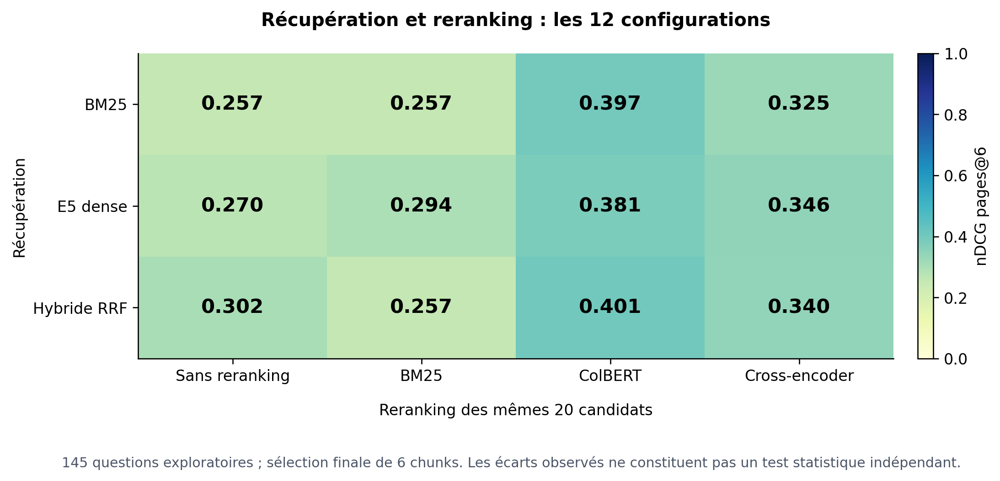
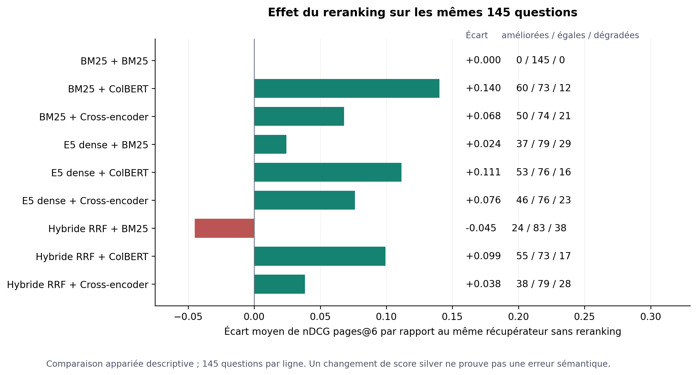
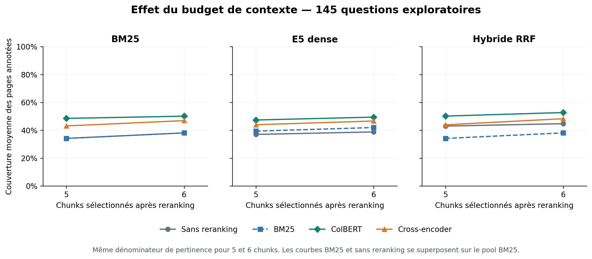
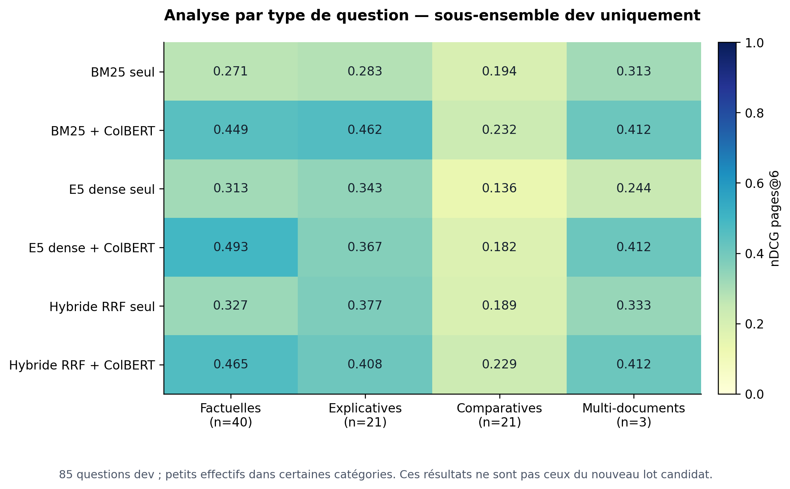

# Optimisation et déploiement d’un RAG pour la question-réponse FOMC

Étude comparative des stratégies de récupération et de reranking — rapport de travail consolidé.
**Résultats exploratoires ; confirmation indépendante et validation de la génération non achevées.**

## Quels résultats conserver ?

Les tableaux de récupération et de reranking restent nécessaires : ils constituent
la comparaison exploratoire actuelle, et non les résultats d’un nouveau test final.
La révision des annotations du lot candidat ne produit pas de nouveaux scores.

| Ensemble ou expérience | Place dans ce rapport |
|---|---|
| 145 questions, corpus actuel de 93 PDF et 1 692 chunks | Comparaison exploratoire conservée, avec un contexte de sortie de six chunks. |
| Anciennes versions à 200 ou 110 questions, ou autre découpage | Non reprises dans les tableaux et graphiques ci-dessous. |
| Nouveau lot candidat de 20 questions | Scores provisoires disponibles ; annotations et indépendance toujours non validées. |
| Essais Streamlit et génération sur dev | Vérifications fonctionnelles et analyse qualitative, distinctes du benchmark de récupération. |

Les fichiers de résultats sources sont conservés pour la traçabilité. Les graphiques
remettent en forme les mesures existantes ; ils ne signalent pas une nouvelle
exécution des modèles. Les nouveaux scores provisoires sont présentés séparément et ne remplacent pas ces résultats exploratoires.

## Résumé

Le projet construit un moteur de recherche de preuves dans les Minutes et Statements
du FOMC, avec production optionnelle de réponses citées par un modèle local. Il compare
trois récupérateurs (BM25, E5 et RRF) et trois reclassements (BM25, ColBERT et
cross-encoder), ainsi que l’absence de reclassement. Sur 145 questions exploratoires,
**RRF + ColBERT** obtient le meilleur nDCG pages@6 observé :
**0.401**. Son contexte contient en moyenne
**52.7 %** des pages pertinentes annotées.
Cela n’établit ni une supériorité universelle ni la qualité des réponses générées.

## Problématique et objectifs

Les rapports monétaires répètent des formulations tout en modifiant les dates,
chiffres et décisions. Retrouver un passage parlant du bon thème ne suffit donc pas :
il faut la bonne réunion, le bon auteur et la bonne période. Nous cherchons à savoir
quelle combinaison priorise le mieux les preuves sous un budget final de six passages.
Le second objectif est la traçabilité : chaque extrait doit renvoyer au document et
à sa page physique, et chaque résultat à une expérience reproductible.

Le périmètre accompli porte principalement sur la recherche, le reranking et leur
évaluation. Une application locale permet la démonstration. L’évaluation complète
de la fidélité de génération et un déploiement public ne sont pas établis.

Un essai applicatif réel de génération a réussi après préchargement du modèle,
mais sa réponse a été jugée partielle et certaines citations portent sur d’autres
réunions. Le [compte rendu technique](VERIFICATION_TECHNIQUE.md) précise cette
limite : un succès fonctionnel ne doit pas être présenté comme une réponse validée.

## Données et statut expérimental

Le corpus comporte **93 PDF**, dont 46 Minutes et 47 Statements,
**838 pages physiques** et **1692 chunks**.
Les sources sont les publications officielles de la Federal Reserve enregistrées
dans le manifeste, avec URL et empreinte de chaque fichier. Les documents couvrent
2021 à 2026 dans le corpus fourni ; la provenance et les dates ne constituent pas
une vérification indépendante de tout leur contenu.

Les 145 questions comprennent 68 factuelles, 42 explicatives, 31 comparatives et
4 multi-documents. Les 279 qrels silver portent sur des pages, avec 188 grades 2
et 91 grades 1. Ces grades ont été conservés. Leur existence et leur localisation
ont été vérifiées techniquement ; leur exhaustivité sémantique n’est pas acquise.

Les étiquettes historiques sont 85 dev, 30 validation et 30 test. Tous ces résultats
ayant été consultés, **les 145 questions sont exploratoires**. Seules les 85 dev
servent à l’analyse détaillée présentée ici. Aucun encodeur, reranker ou LLM n’est
entraîné ou affiné localement : les poids préentraînés restent fixes. Cela explique
l’absence d’un lot d’entraînement supervisé local, mais ne supprime pas les risques
de sélection de paramètres sur les scores déjà observés.

Le code, les paramètres, modèles et index ont été figés avant la préparation d’un
nouveau lot candidat. Celui-ci compte 20 questions et 294 propositions de grades de
pages, dont 78 positives. **Ce ne sont pas encore des annotations indépendantes
approuvées** : les négatifs de la dernière passe doivent notamment être relus sur
les pages complètes. Une mesure provisoire est désormais disponible, sans statut de test final validé.

## Prétraitement et analyse exploratoire

Les PDF sont extraits en respectant l’ordre des colonnes et les lignes à plusieurs polices. Les montants, fractions, dates et négations sont conservés. Les passages ont au plus 400 tokens de corps, avec chevauchement de 60 tokens et une entrée complète sous la limite du modèle. Le chevauchement réduit la perte d’information aux frontières, mais crée des passages qui partagent du texte.

Chaque chunk conserve son document, sa date, ses paragraphes et la contribution en caractères de chaque page physique. L’inventaire du contenu, les empreintes des fichiers et les longueurs sont contrôlés. Toutes les pages à contribution positive restent dans la provenance ; une contribution faible ne devient pas une preuve de pertinence.

`audit_project.py` produit les distributions par année, longueur de chunk et type de question, les contrôles de valeurs vides et d’identifiants dupliqués, ainsi que les recouvrements de pages annotées entre les étiquettes de lots. Un corpus partagé entre questions est normal pour la recherche documentaire ; le risque vient notamment du réglage des méthodes sur les questions utilisées ensuite pour annoncer un résultat final.

## Récupération : trois méthodes

### BM25 : référence lexicale

BM25 additionne les contributions des termes de la question. Pour chaque terme, son IDF mesure sa rareté dans le corpus. Sa fréquence dans le passage est saturée et corrigée par la longueur du passage :

`score(q,d) = somme_t IDF(t) × f(t,d)(k1+1) / [f(t,d) + k1(1−b+b×|d|/longueur_moyenne)]`.

Le projet utilise `rank-bm25`, k1=1,5 et b=0,75. Les IDF et la longueur moyenne proviennent de l’ensemble du corpus, y compris lors du reclassement d’un sous-ensemble. La méthode convient aux dates, montants et termes exacts, mais peut manquer des formulations sémantiquement proches sans mots communs.

### Recherche dense E5

`intfloat/e5-small-v2` encode la question avec le préfixe `query:` et le passage avec `passage:`. Les vecteurs de 384 dimensions sont normalisés. Le score est leur produit scalaire, équivalent au cosinus lorsque les normes valent 1. La recherche est exacte sur les mêmes identifiants de chunks que BM25. Elle peut rapprocher des reformulations, mais un sujet similaire ne garantit pas la bonne réunion ni la bonne valeur numérique.

### Fusion hybride RRF

RRF combine les rangs des listes BM25 et E5 : `RRF(d) = somme_m 1/(60 + rang_m(d))`. Un document absent d’une liste ne reçoit aucune contribution de cette liste. La fusion évite d’additionner des scores BM25 et cosinus qui n’ont pas la même échelle. Les deux listes sont tronquées à 20, puis la fusion fournit 20 candidats. L’étude de profondeur `compare_rrf_depth.py` est une expérience distincte ; ses résultats ne constituent pas un test indépendant si les mêmes questions servent à sélectionner la profondeur.

## Reranking et sélection finale

Le reranker attribue de nouveaux scores aux **20 mêmes candidats**, puis le système conserve les **6 meilleurs passages**, ou 5 si ce budget est choisi. Le reranking n’effectue pas une nouvelle recherche dans tout le corpus. Sélectionner 6 sorties ne signifie pas que seuls 6 candidats ont été scorés.

- **BM25** : reclassement lexical avec les statistiques globales. Appliqué à son propre classement, il constitue un contrôle d’identité.
- **ColBERT** : l’encodeur BERT et sa projection apprise représentent chaque token dans un espace de 96 dimensions. Le score MaxSim est `s(q,d) = somme_i max_j cos(q_i,d_j)`. Les marqueurs de rôle, la normalisation et le masquage des tokens documentaires suivent l’adaptateur du checkpoint. Le modèle utilise jusqu’à 64 tokens de question et 512 de document, sans expansion de requête. Les représentations documentaires peuvent être précalculées.
- **Cross-encoder** : `cross-encoder/ms-marco-MiniLM-L6-v2` lit conjointement la paire question/passage et produit un logit de pertinence. Ce score n’est pas présenté comme une probabilité calibrée. La limite est de 512 tokens ; le document est tronqué si nécessaire. Chaque paire doit être évaluée conjointement, d’où un coût différent du bi-encodeur.

Les révisions sont figées dans `common.py`. Les rangs et les scores complets sont conservés pour les contrôles ; les fichiers `*_top5.jsonl` et `*_top6.jsonl` contiennent les sorties retenues. Les expériences de contexte comparent tous les classements avec le même budget final, y compris les classements sans reranking.

## Génération et variante temporelle

Le chemin classique fournit les 5 ou 6 passages à Ollama, avec leurs identifiants de sources. L’utilisateur doit installer le modèle local indiqué dans l’application. Les contrôles de citations vérifient les identifiants et certaines contraintes structurelles ; ils ne démontrent pas automatiquement que chaque affirmation découle du texte cité.

Le module temporel est une variante exploratoire : il détecte les périodes demandées, recherche des preuves par période et ajoute des heuristiques de décision ou de justification. Il est plafonné à 6 passages au total. Cette politique ajoute des règles au pipeline classique ; elle ne doit pas être présentée comme le même système que celui mesuré dans le benchmark standard. Le mode utilisé est affiché dans l’application.

## Évaluation et interprétation

Les 279 annotations silver portent sur des pages, avec grades 1 et 2. Les grades sont conservés. Les pages des chunks sont dédoublonnées dans leur ordre d’apparition, avec ordre physique à l’intérieur d’un chunk multipage. Cette convention impose un ordre aux pages d’un même chunk et doit être indiquée dans le rapport.

- **Recall@K** : proportion des pages pertinentes annotées présentes parmi les K premières pages uniques.
- **nDCG@K** : gain `2^grade−1`, décote `log2(rang+1)`, division par le classement idéal calculé sur tous les qrels de la question.
- **MRR@K** : inverse du premier rang pertinent jusqu’à K, sinon zéro, moyenné sur les questions.
- **Couverture du contexte final** : proportion des pages annotées présentes dans les 5 ou 6 chunks effectivement sélectionnés, sans assimiler le budget de chunks au nombre de pages.
- **Couverture du pool** : même mesure sur tous les 20 candidats ; elle est invariante après reclassement à pool fixe.

Une page pertinente peut correspondre à une petite portion du chunk, sans que la phrase répondant à la question soit présente. Les qrels de pages ne sont donc pas des jugements de chunks. Une page non annotée est notée zéro pour les métriques, sans preuve de non-pertinence. Les résultats silver nécessitent une interprétation prudente et une revue humaine ciblée.

L’analyse des erreurs distingue les contextes sans page annotée, partiellement couverts ou couvrant toutes les pages annotées. Elle est ventilée par méthode et type de question. Les classements avant/après et les diagnostics lexicaux aident à examiner les cas ; une perte de score peut aussi révéler une annotation incomplète. Le texte des PDF doit être lu avant d’attribuer une cause.

Les latences sont exploratoires : chargements, préencodage ColBERT et coût partagé de requête sont rapportés séparément lorsque disponibles. Les durées du benchmark ne sont pas celles d’une requête froide dans l’application, où les documents ColBERT peuvent être réencodés. Aucun gain de vitesse lié à la seule sélection top-6 n’est revendiqué.

## Comparaison exploratoire actuelle — 145 questions, six chunks en sortie

Le tableau utilise les mêmes 145 questions et qrels historiques pour les 12
configurations. La couverture concerne toutes les pages des six chunks ; nDCG et
MRR sont coupés aux six premières pages uniques. Six chunks peuvent contenir plus
de six pages : ces indicateurs n’ont donc pas exactement le même périmètre.

| Récupération | Reranking | Couverture contexte | Toutes références | nDCG pages@6 | MRR pages@6 |
|---|---|---:|---:|---:|---:|
| bm25 | none | 0.381 | 0.276 | 0.257 | 0.272 |
| bm25 | bm25 | 0.381 | 0.276 | 0.257 | 0.272 |
| bm25 | colbert | 0.501 | 0.393 | 0.397 | 0.421 |
| bm25 | cross_encoder | 0.469 | 0.352 | 0.325 | 0.345 |
| dense | none | 0.388 | 0.269 | 0.270 | 0.294 |
| dense | bm25 | 0.420 | 0.297 | 0.294 | 0.328 |
| dense | colbert | 0.494 | 0.372 | 0.381 | 0.414 |
| dense | cross_encoder | 0.466 | 0.359 | 0.346 | 0.374 |
| hybrid_rrf | none | 0.447 | 0.338 | 0.302 | 0.318 |
| hybrid_rrf | bm25 | 0.381 | 0.276 | 0.257 | 0.272 |
| hybrid_rrf | colbert | 0.527 | 0.400 | 0.401 | 0.433 |
| hybrid_rrf | cross_encoder | 0.483 | 0.379 | 0.340 | 0.363 |

Le nDCG observé de RRF + ColBERT dépasse celui de BM25 seul de
0.144 point.
En revanche, il ne dépasse BM25 + ColBERT que de
0.0042 point.
**Cette faible différence n’est pas une preuve de supériorité statistique.**
Aucun test confirmatoire indépendant ni intervalle tenant compte de toutes les
dépendances entre questions n’est présenté. La combinaison retenue constitue un
choix exploratoire figé pour une future confirmation.

Les mesures sur le pool complet de 20 candidats donnent d’autres scores, notamment
un nDCG pages@10 ; ils servent au diagnostic du pool et ne doivent pas être confondus
avec le tableau du contexte de six chunks. Le nombre 20 désigne le pool à reclasser,
pas le nombre de passages transmis au générateur. Les latences après échauffement excluent certains
chargements et préencodages : elles ne démontrent pas la vitesse d’une requête froide
dans l’application, qui peut réencoder les documents ColBERT.

## Évaluation provisoire supplémentaire — 20 questions

[Tableaux, graphique et limites du calcul](../results/candidate_provisional/20261120T151147Z/RAPPORT.md). Les 12 configurations sont évaluées sur les grades proposés, aux budgets de cinq et six chunks. Aucun paramètre du système figé n’est modifié. Ce calcul ne remplace pas la validation indépendante des annotations.

**Le lot est désormais exposé aux scores.** Tout réglage guidé par ces résultats nécessite une autre confirmation. La qualité des réponses générées reste à évaluer séparément.

## Graphiques de comparaison

Toutes les figures ci-dessous utilisent les résultats exploratoires existants.
Elles sont disponibles en PNG et en SVG dans [l’index des figures](../results/figures/INDEX.md),
avec les sources et leurs empreintes. Aucune ne représente le test final indépendant.

### Récupération seule

Les trois récupérateurs sont comparés sans reranking. La couverture porte sur
toutes les pages des six chunks ; nDCG et MRR sur six pages uniques.

### Les douze configurations

La matrice compare chaque reranker sur le même pool de vingt candidats de son
récupérateur. Le contrôle BM25 sur son propre classement conserve le score.

### Effet du reranking

Chaque ligne est comparée au même récupérateur sans reranking, question par
question. Les nombres de questions améliorées, inchangées et dégradées complètent
la moyenne. Ce diagnostic est descriptif et dépend des références silver.

### Budget de contexte

La couverture des pages utilise le même dénominateur pour cinq et six chunks.
Cette figure montre l’effet du budget de sortie, sans prétendre que la sélection
de six passages évite le scoring des vingt candidats.

### Analyse par type sur dev

L’analyse détaillée porte seulement sur les 85 questions dev, avec les effectifs
affichés. La catégorie multi-documents n’a que trois questions dans ce sous-ensemble :
sa moyenne ne permet pas une conclusion robuste sur toutes les comparaisons documentaires.

## Interprétabilité par analyse des erreurs

Le diagnostic automatique existant comporte 1 020 lignes : 85 questions dev × 12
configurations. Ses catégories décrivent la couverture des pages silver ; ce sont
des indicateurs de tri, pas des causes d’erreurs validées.

La revue de trois cas dans
[ANALYSE_QUALITATIVE_DEV.md](../results/audit_project/ANALYSE_QUALITATIVE_DEV.md)
ajoute les textes effectivement retenus et les citations vérifiées dans les PDF :

- **FOMC_004** : score nul alors qu’un passage de la bonne réunion énonce l’amélioration
  de l’activité et de l’emploi ; une page alternative des Minutes manque aux qrels.
- **FOMC_035** : baisse de couverture silver après ColBERT, mais promotion au rang 1
  d’un passage de janvier 2022 expliquant inflation élevée et travail solide. La perte
  de score n’est pas à elle seule une perte démontrée de capacité à répondre.
- **FOMC_064** : la même preuve passe du quatrième au premier chunk. Sa page passe
  du septième au premier rang des pages uniques ; nDCG@6 passe de 0 à 1, alors que
  la preuve figurait déjà dans les six chunks avant reclassement.

Ces exemples sont sélectionnés pour expliquer les mécanismes, sans prétendre estimer
leur fréquence. Deux nouvelles références sont proposées dans un fichier séparé ;
elles ne modifient pas les annotations figées et aucun score historique n’est réécrit.
L’analyse d’erreurs est ici la méthode d’interprétabilité adaptée à la consigne ECC ;
un graphique SHAP n’est pas requis pour comprendre ces classements documentaires.

## Démonstration et reproductibilité

Le [compte rendu des vérifications techniques](VERIFICATION_TECHNIQUE.md) distingue
les tests automatisés, les essais Streamlit réels, la génération et le statut du
test final indépendant. Le démarrage d’une application ne prouve pas, à lui seul,
que toute la chaîne fonctionne ni que ses réponses sont justes.

L’application Streamlit orchestre recherche, reranking, sélection de cinq ou six
passages et génération optionnelle via Ollama. Elle offre une démonstration locale,
pas un hébergement public certifié. La variante temporelle est exploratoire et
distincte du système classique comparé. Les commandes d’installation et d’exécution
sont dans le [README](../README.md). La présence d’un dépôt Git et d’une URL distante
configurée ne prouve pas que les dernières modifications y ont été publiées.

Le protocole figé vérifie les empreintes des sources, code, paramètres, index et
révisions de modèles. Les tests contrôlent notamment les métriques, l’alignement
des pages, l’identité des candidats avant/après reranking et le budget de contexte.
Les artefacts de revue sont produits hors du code figé, sans appel des modèles.

## Limites et travaux nécessaires avant la conclusion finale

Les qrels silver sont incomplets dans certains cas observés ; les pages ne jugent
pas directement le contenu de chaque chunk. Les questions partagent des sources et
les scores déjà vus ne sont pas indépendants. Les résultats ne prouvent pas que la
génération est correcte ou que les citations impliquent toutes les affirmations.
Le nouveau jeu reste à confirmer sur les plans sémantique et documentaire.

Avant une évaluation finale : faire confirmer les annotations et réponses, résoudre
les désaccords, contrôler les doublons sémantiques et figer une version approuvée.
Une seule mesure du pipeline figé pourra alors être présentée comme confirmation
de ce système, avec ses limites. Toute optimisation guidée par ces nouveaux scores
exigera un autre jeu de confirmation.

Le présent rapport rassemble contexte, méthode, résultats et discussion ; il reste
à relire et à mettre en forme selon les attentes académiques. Les diapositives et
la vidéo de démonstration de 15–20 minutes restent des livrables distincts à préparer.

## Traçabilité des documents de travail

- [Méthodologie détaillée](METHODOLOGIE.md).
- [Tableau de conformité aux consignes](CONFORMITE_ECC.md).
- [Scores exploratoires de sortie top-6](../results/context_top6/comparison.csv).
- [Profil exploratoire et figures](../results/audit_project/RAPPORT.md).
- [Préannotation du lot candidat](../data/holdout_candidate/assistant_review/completed_proposal/RAPPORT.md).
- [Verrou du pipeline](../protocol/frozen_pipeline_20261120.json).

## Références scientifiques

Les [références primaires vérifiées](REFERENCES.md) couvrent BM25, E5, RRF,
ColBERT et le reranking neuronal avec BERT. Elles expliquent les principes ;
les checkpoints et paramètres réellement employés sont ceux du verrou du projet.
La liste et son format bibliographique restent à relire selon les exigences de remise.
