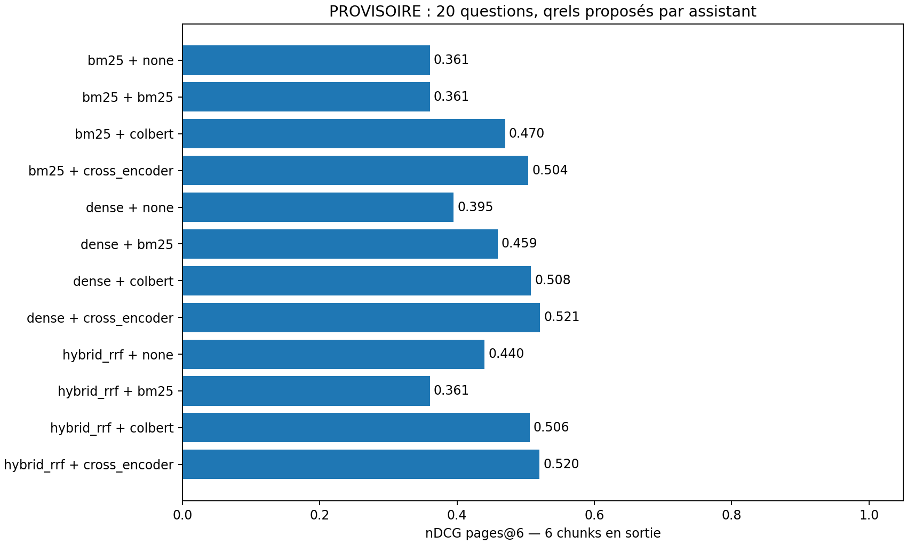

# Évaluation provisoire du lot candidat de 20 questions

**Ce calcul ne constitue pas un test final indépendant validé.** Les 294 grades sont des propositions de l’assistant ; les validations humaines et sémantiques restent absentes. Le lot est désormais exposé aux scores. Aucun réglage n’est effectué à partir de ceux-ci.

Les modèles figés reçoivent seulement le texte des questions, avec les mêmes index et paramètres. Chaque reranker conserve les 20 candidats de son récupérateur ; 5 et 6 chunks sont évalués séparément. Les qrels sont chargés après fixation des classements.

## Budget principal : six chunks

| Recherche | Reranker | Couverture | Toutes les références | nDCG pages@6 | MRR pages@6 |
|---|---|---:|---:|---:|---:|
| bm25 | none | 0.419 | 0.300 | 0.361 | 0.446 |
| bm25 | bm25 | 0.419 | 0.300 | 0.361 | 0.446 |
| bm25 | colbert | 0.511 | 0.350 | 0.470 | 0.631 |
| bm25 | cross_encoder | 0.511 | 0.350 | 0.504 | 0.717 |
| dense | none | 0.498 | 0.350 | 0.395 | 0.514 |
| dense | bm25 | 0.542 | 0.350 | 0.459 | 0.635 |
| dense | colbert | 0.550 | 0.350 | 0.508 | 0.618 |
| dense | cross_encoder | 0.535 | 0.350 | 0.521 | 0.667 |
| hybrid_rrf | none | 0.478 | 0.300 | 0.440 | 0.577 |
| hybrid_rrf | bm25 | 0.419 | 0.300 | 0.361 | 0.446 |
| hybrid_rrf | colbert | 0.557 | 0.400 | 0.506 | 0.645 |
| hybrid_rrf | cross_encoder | 0.532 | 0.400 | 0.520 | 0.692 |

Système choisi avant cette mesure : **RRF + ColBERT**, nDCG pages@6 provisoire **0.506**. Le meilleur score observé après calcul ne remplace pas automatiquement ce choix.

## Limites et suite

Les pages non annotées comptent zéro sans preuve de non-pertinence. Les références sont des pages et ne prouvent pas la présence de la réponse dans le chunk. Les 20 questions sont peu nombreuses et certaines partagent des sources. Aucune supériorité statistique ou qualité de génération n’est établie.

Restent : validation indépendante des grades, nouveauté sémantique et réponses ; correction versionnée de la génération partielle et des citations hors réunion ; évaluation de réponses générées ; contrôle du paquet de reproduction sur un autre environnement. Si le système est corrigé à partir de ce lot, préparer une nouvelle confirmation indépendante.

Reproduction : `.\.venv\Scripts\python.exe scripts/score_candidate.py --provisional`. Chaque exécution crée un dossier distinct. Les 145 questions, leurs résultats et les grilles humaines sont préservés.
