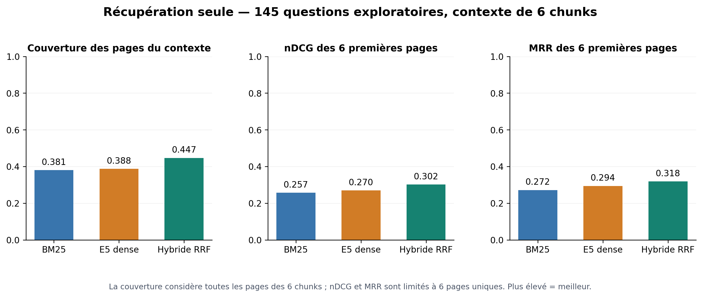
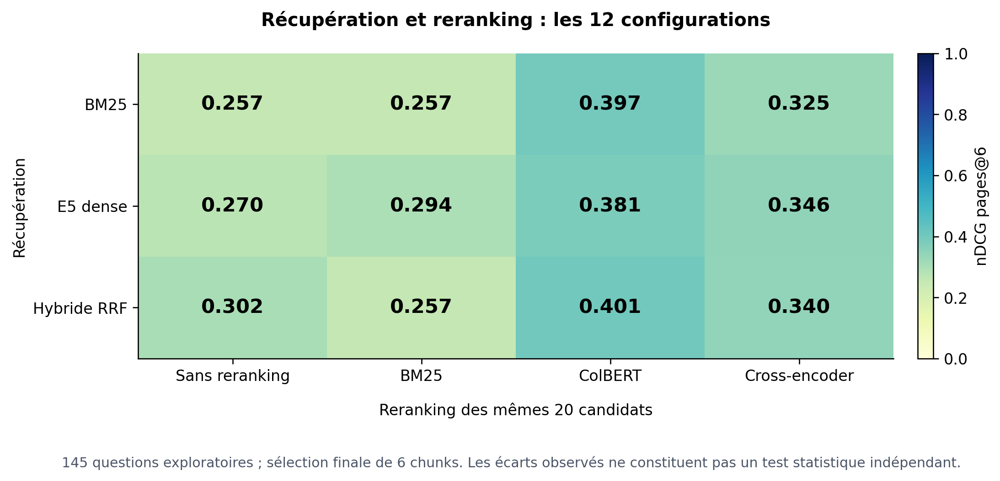
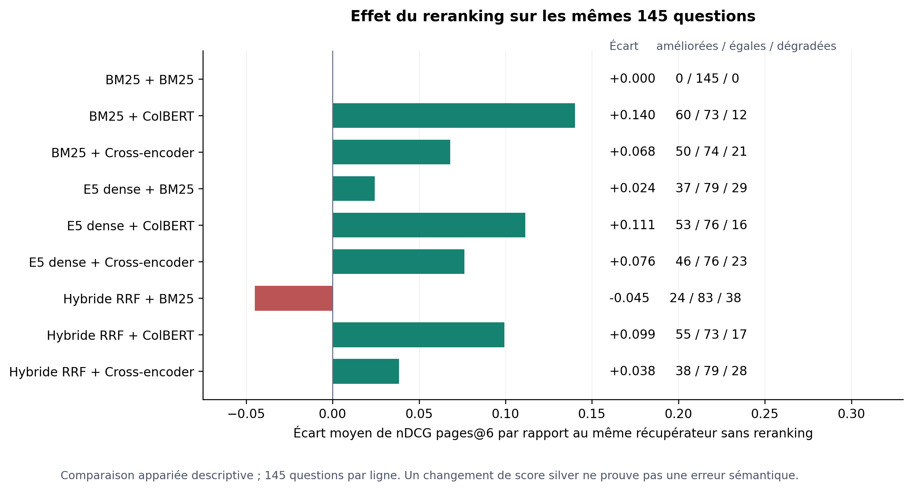
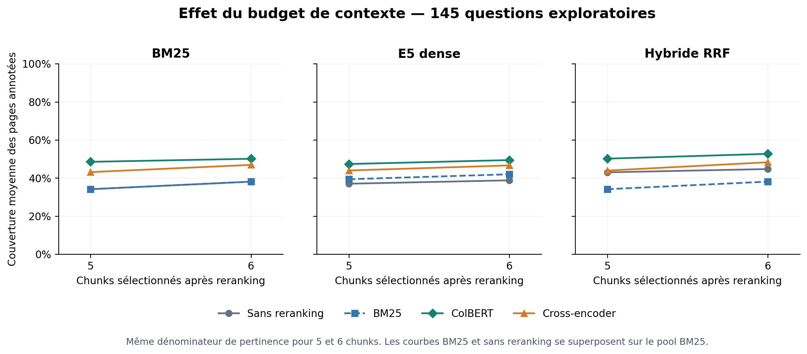
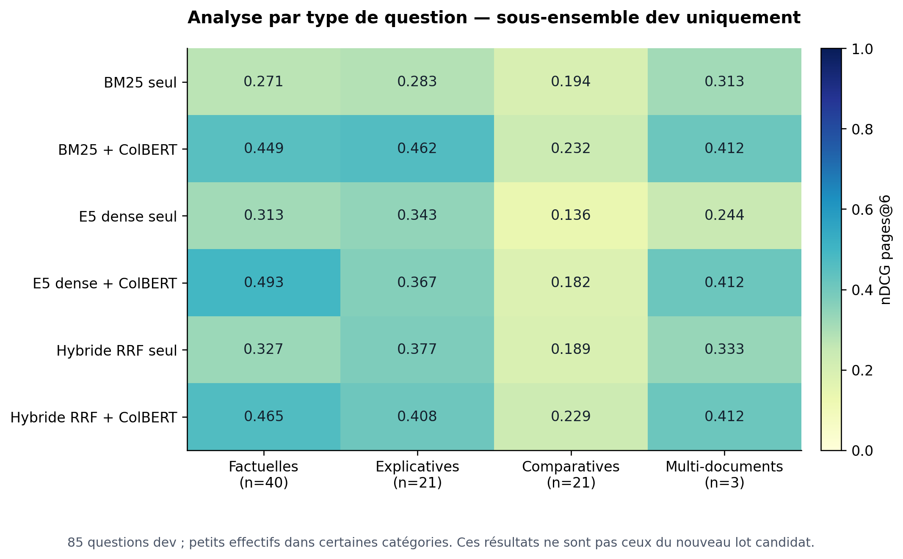

# Graphiques de la comparaison exploratoire actuelle

**Résultats exploratoires des 145 questions ; aucune figure ne provient du test final indépendant.**

Ces résultats sont conservés comme référence exploratoire. Les [scores supplémentaires des 20 questions](../candidate_provisional/INDEX.md) restent provisoires ; leurs grades ont été acceptés globalement par l’utilisateur, sans indépendance établie. Les anciennes versions à 200 ou 110 questions ne sont pas représentées ici.

Chaque figure est disponible en PNG et SVG. Les valeurs viennent des fichiers CSV existants, sans nouvelle exécution des modèles. Les empreintes des entrées figurent dans `provenance.json`.

## Récupération seule

[Version SVG](01_recuperation.svg)

## Les 12 configurations de récupération/reranking

[Version SVG](02_reranking.svg)

## Gains et pertes appariés du reranking

[Version SVG](03_effet_reranking.svg)

## Budget de cinq ou six chunks

[Version SVG](04_budget_contexte.svg)

## Types de questions sur dev

[Version SVG](05_types_dev.svg)
